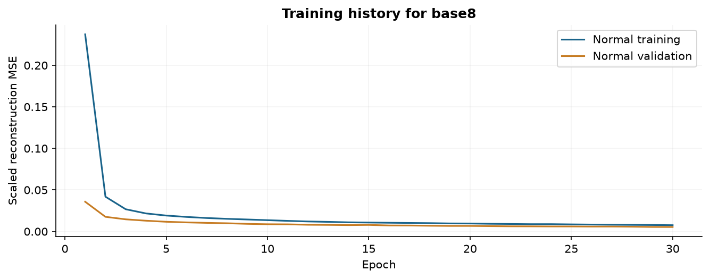
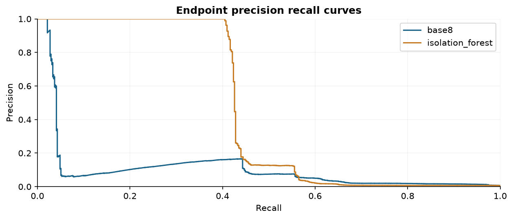
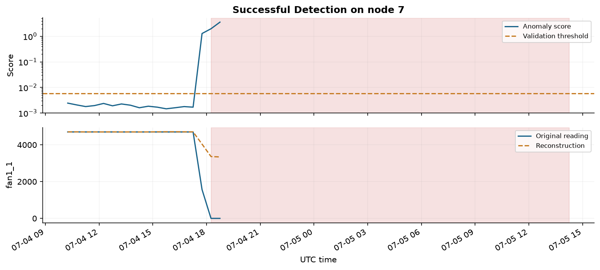
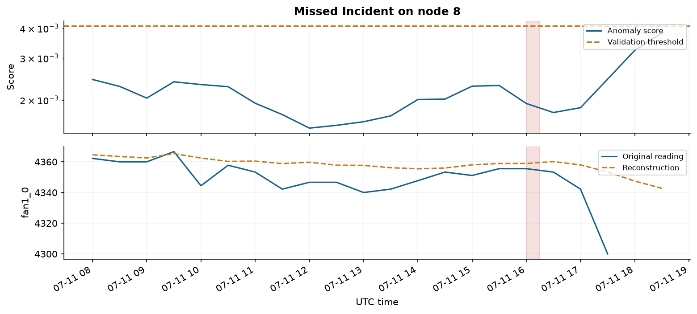
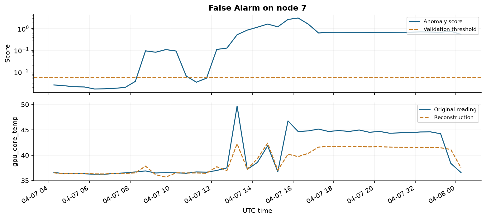

Anomaly Detection in Data Center Telemetry using an LSTM Autoencoder

Deep Learning Project Report Section B 12 October 2026

| Team member | Student ID |
| --- | --- |
| Rishabh Srivastava | 2430010149 |
| Mitul Seth | 2430010099 |
| Madhav Mittal | 2430010096 |

Abstract

This project evaluates an LSTM autoencoder for detecting unusual thermal, fan and power behaviour in Marconi100 telemetry. The study uses 751,363 readings from nine nodes, normal-only reconstruction training and chronological validation and test periods. We compare sequence lengths, added sensor features, scaling, anomaly-score definitions and alarm rules. Settings are selected on labelled validation data. The selected LSTM experiment is **base8**, with endpoint average precision 0.1031, precision 2.1%, recall 72.3% and F1 0.0411 on its test cohort. It detects 17 of 34 raw alert incidents; 22 incidents have a scored timestamp inside them. The saved model supports recorded replay and fresh CSV inference. The results demonstrate a functioning anomaly-monitoring workflow while exposing false alarms, incomplete coverage and differences between reconstruction-based and tree-based ranking.

The reference labels describe general server health. Cooling-specific diagnosis, prediction of future faults and production deployment are outside the demonstrated scope.

## 1 Introduction and related work

Temperature, fan speed and power vary together as a server changes operating conditions. A monitor that learns their relationships can identify unusual combinations that a single fixed sensor limit may miss. This project asks how well normal reconstruction behaviour separates recorded server-health alerts from routine telemetry, and how much the alarm burden changes with practical design choices.

Objectives

The objectives are to train a recurrent reconstruction model on normal telemetry, compare it with Isolation Forest, evaluate both scores and timestamped incidents, quantify false alarm bursts and detection delay, and provide an inspectable dashboard with a saved model. A useful outcome is a defensible experimental comparison even when detection quality remains limited.

Related work

Hochreiter and Schmidhuber introduced LSTM to support learning over extended temporal dependencies [1]. Malhotra et al. proposed an LSTM encoder-decoder that reconstructs normal multivariate sensor sequences and detects anomalies from reconstruction error [2]. Our model follows this general reconstruction principle, with a compact bottleneck and explicit validation-based alarm calibration.

The Marconi100 data publication provides production telemetry and a time-aggregated anomaly-detection dataset with Nagios labels [3, 4]. Its distinction between thermal hazard analysis and general node anomaly detection is relevant to the scope of this project. We use the latter labels with thermal and power features.

Isolation Forest isolates observations through random feature splits; observations isolated quickly receive higher anomaly scores [5]. It provides a practical non-neural baseline. The project compares ranking quality and alarm policies rather than assuming that a recurrent network must outperform a simpler model.

Project contribution

The contribution is an implemented evaluation and demonstration workflow: chronological preprocessing, five independently trained LSTM configurations, validation-only selection, corrected incident accounting, a persisted baseline, sensor reconstruction explanations and fresh-input inference. The architecture is an application of established methods, rather than a new anomaly-detection algorithm.

## 2 Dataset and preprocessing

The source is the M100 time-aggregated dataset, distributed as rack tarballs containing one Parquet file per node [4]. The local rack archive contains sixteen node files. This study fixes a nine-node subset (7, 8, 9, 10, 11, 13, 14, 16, 17) across the base comparisons for consistent scope and manageable computation. The included timestamps run from 2020-03-09 to 2022-09-28. Results describe this subset and cannot estimate performance across the full supercomputer.

| Dataset field | Observed value |
| --- | --- |
| Reduced readings | 751,363 |
| Base features | 22 |
| Enhanced features | 33 |
| Aggregation cadence | 15 minutes |
| Normal labels | 660,172 |
| CRITICAL labels | 9,429 |
| Missing labels | 81,715 |
| Other labels | 47 |

Base features include ambient temperature, eight fan readings, fan disk power, CPU voltage-regulator temperatures, mean DIMM and component temperatures, processor and total power, and two power-supply input measurements. Averaging reduces dimensionality but can hide a hot component. Enhanced features add temperature maxima, fan minimum and spread, temperature above ambient, reading changes and power-supply output voltage.

Within each node, records are sorted by time. Forward filling is causal and limited to four readings. A timestamp gap resets the fill history. The first 70% of rows form training, the next 10% validation, and the last 20% testing. Scalers are fitted on finite normal training rows. Standard-scaling experiments clip values to the interval [-5, 5]; the robust-scaling experiment uses median and interquartile range with no clipping [6].

Windows remain inside one split and contain only known normal or CRITICAL labels, finite model inputs and consecutive 15-minute timestamps. Training uses normal-only windows with stride four. Validation and testing use stride two. Labels do not enter the neural-network input. Dropped windows and unavailable scoring opportunities are included in the coverage discussion.

## 3 Model and training

The encoder reads a multivariate sequence and produces a 64-dimensional final hidden state. A linear layer compresses this to a 16-dimensional latent vector. Repeating the latent vector across the input width supplies the decoder, whose reconstructed features pass through a final linear layer. Training minimises mean squared reconstruction error.

| Layer | Output for one sequence |
| --- | --- |
| Input | 8 time steps by 22 features |
| LSTM encoder | 64 hidden values |
| Linear bottleneck | 16 latent values |
| Latent repeat | 8 steps by 16 values |
| LSTM decoder | 8 steps by 64 values |
| Linear output | 8 steps by 22 features |

| Training setting | Value |
| --- | --- |
| Optimiser | Adam |
| Learning rate | 0.001 |
| Batch size | 512 |
| Maximum epochs | 30 |
| Early stopping | Patience 5 on normal validation MSE |
| Random seed | 42 |
| Encoder and decoder hidden size | 64 |
| Latent size | 16 |
| Selected model parameters | 45,990 |
| Runtime | PyTorch on CPU with four compute threads |

For a window x with W readings and F features, the whole-window score is the mean of (x - reconstruction) squared over W and F. The latest-reading score averages the error only across the final F values. The latter directly emphasises the reading whose label is evaluated, while the former includes earlier context.

The original TensorFlow notebook and its saved scores remain a separate reference experiment. The new PyTorch runs are independently trained reproductions of the same conceptual encoder-decoder design. Their weights, framework bias conventions, batch size and validation sampling differ, so they are not presented as an exact numerical recreation of the TensorFlow run.

## 4 Evaluation and incident definitions

Two targets are reported separately. The legacy window target is positive when any reading in the input window is CRITICAL. The endpoint target is positive only when the original label at the scored timestamp is CRITICAL. The original six-hour test cohort has 761 positive overlapping windows but only 432 CRITICAL endpoints. This distinction prevents an alarm after an alert has ended from being counted as an on-time endpoint detection.

A raw incident consists of adjacent original CRITICAL bins for the same node. A non-CRITICAL label or missing timestamp breaks an incident. Each 15-minute aggregation bin is represented by a half-open interval from its timestamp to the next 15-minute boundary. An incident is detected only if an emitted alarm timestamp falls inside its original interval. Delay is measured from the incident start to the first matching alarm timestamp, and is therefore resolved only at the available aggregation cadence.

| Measure | Definition |
| --- | --- |
| Average precision | Threshold-independent summary of the precision recall curve [7] |
| Precision and recall | Endpoint label comparison after applying the selected alarm rule |
| Incident recall all | Detected raw incidents divided by all raw incidents |
| Incident recall observable | Detected incidents divided by incidents with a scored timestamp inside them |
| False bursts | Consecutive alarm timestamps with no timestamp inside a raw incident |
| Scored node-day | Number of scored bins multiplied by 30 minutes and divided by 1440 |
| Median delay | Median delay among detected incidents only |

The corrected original cohort contains 34 raw incidents. Only 22 have scoring opportunities; short incidents, filtering and stride-two sampling can remove opportunities. Both recall denominators are retained. Adjacent alarm rows are merged only when their timestamps are exactly 30 minutes apart. Persistence streaks also reset at node changes and gaps. False burst rates exclude unscored exposure, and false alarms are interpreted relative to the available Nagios labels.

The experiments use previously explored recordings rather than a newly collected external test set. Validation controls the new setting choices, but conclusions remain exploratory because the test period was inspected during earlier project development.

## 5 Experiments and validation selection

| Experiment | History | Feature set | Scaling |
| --- | --- | --- | --- |
| base24 | 24 readings | Base 22 | Standard clip 5 |
| base48 | 48 readings | Base 22 | Standard clip 5 |
| base8 | 8 readings | Base 22 | Standard clip 5 |
| enhanced24 | 24 readings | Enhanced 33 | Standard clip 5 |
| isolation_forest | 24 readings | Base 22 | Standard clip 5 |
| robust24 | 24 readings | Base 22 | Robust no clip |

The base24 experiment supplies a six-hour reference. Base8 and base48 change the history length while retaining the base features and scaling. Enhanced24 tests the expanded feature set. Robust24 changes both the scaler and clipping policy, so its result cannot isolate those two effects individually. All neural runs use seed 42 and the same optimiser, maximum epochs, batch size and early-stopping rule. Different widths and feature availability change the retained cohorts.

For each neural model, normal validation scores calibrate percentile thresholds at 95, 99 and 99.5. Each percentile is evaluated globally and separately by node, with immediate alarms or two consecutive high readings. Both whole-window and latest-reading scores are evaluated. This produces 24 policies per neural configuration. Labelled validation endpoint F1 selects the policy; ties use raw incident recall and then a lower false burst rate. The LSTM configuration is selected by the same validation criterion. Isolation Forest selects from twelve alarm policies on the same six-hour base cohort.

| Experiment | Validation F1 | Selected score | Alarm rule |
| --- | --- | --- | --- |
| base24 | 0.0275 | whole window | q95 node, k=1 |
| base48 | 0.0144 | latest reading | q99 global, k=1 |
| base8 | 0.0750 | whole window | q95 node, k=1 |
| enhanced24 | 0.0645 | whole window | q95 global, k=1 |
| isolation_forest | 0.0489 | Isolation score | q95 node, k=2 |
| robust24 | 0.0163 | whole window | q95 node, k=1 |

The selected LSTM is **base8**. Its normal training set contains 105,150 windows; its validation cohort contains 37,074 windows and 388 CRITICAL endpoints. Selection uses validation data even when another experiment has a more favourable test metric. One seed and relatively few incidents limit the stability of this selection.

## 6 Training behaviour and alarm filtering

Figure 1 Training and normal validation reconstruction loss for base8.

The selected run completed 30 epochs. The best normal validation MSE was 0.005383; best weights were restored before scoring. Lower reconstruction loss indicates improved reconstruction on that scale, but does not by itself establish better anomaly discrimination. Loss values across scaling policies or feature sets should not be used to rank detectors.

Fixed alarm sensitivity check on the original model

| 99th percentile rule | Endpoint precision | Raw incidents caught | False bursts |
| --- | --- | --- | --- |
| k=1 | 5.8% | 13/34 | 479 |
| k=2 | 6.5% | 13/34 | 364 |

At this fixed threshold, requiring two consecutive high readings reduces false bursts from 479 to 364 (24.0%), while the detected raw-incident count remains 13. This is a retrospective sensitivity observation on the original saved scores, not a validation-selected performance claim. Alarm filtering can also increase delay or miss brief alerts in other cohorts.

## 7 Test results

| Experiment | AP | Precision | Recall | F1 | Incidents |
| --- | --- | --- | --- | --- | --- |
| base24 | 0.096 | 1.9% | 70.8% | 0.037 | 16/34 |
| base48 | 0.145 | 5.3% | 61.7% | 0.098 | 11/34 |
| base8 | 0.103 | 2.1% | 72.3% | 0.041 | 17/34 |
| enhanced24 | 0.048 | 2.6% | 65.9% | 0.050 | 15/34 |
| isolation_forest | 0.447 | 1.6% | 61.8% | 0.030 | 14/34 |
| robust24 | 0.481 | 1.3% | 53.7% | 0.025 | 16/34 |

Figure 2 Endpoint precision recall curves for the validation-selected LSTM and the six-hour Isolation Forest baseline.

The selected LSTM has average precision 0.1031, compared with 0.4473 for Isolation Forest. At their separately validation-selected alarm policies, the LSTM emits 1056 false bursts and catches 17 raw incidents; Isolation Forest emits 443 and catches 14. These are different ranking and operating-point measures. The results do not support a universal claim of neural-model superiority.

The selected LSTM produces 0.692 false bursts per scored node-day. Its median delay of 0.0 minutes describes detected incidents only. Missed and unobservable incidents remain relevant. Comparisons involving different window lengths use different retained cohorts, so aggregate differences combine model behaviour and coverage effects.

## 8 Variation across servers

| Node | Scored endpoints | CRITICAL endpoints | LSTM AP | Baseline AP |
| --- | --- | --- | --- | --- |
| 7 | 8247 | 16 | 0.090 | 0.003 |
| 8 | 8071 | 15 | 0.077 | 0.002 |
| 9 | 8246 | 15 | 0.536 | 0.003 |
| 10 | 8237 | 397 | 0.280 | 0.606 |
| 11 | 8247 | 13 | 0.125 | 0.003 |
| 13 | 8072 | 13 | 0.164 | 0.002 |
| 14 | 8247 | 13 | 0.161 | 0.002 |
| 16 | 7861 | 17 | 0.075 | 0.004 |
| 17 | 8072 | 13 | 0.163 | 0.005 |

Node 10 supplies 397 of 512 critical endpoints (77.5%) in the selected cohort. Global score metrics therefore give substantial influence to this node. The arithmetic mean of per-node AP is 0.1857 for the selected LSTM and 0.0700 for the baseline. This equal-node summary complements the global comparison but is unstable on nodes with few positive endpoints.

The baseline uses the six-hour cohort, while the selected LSTM may use another history width. Its per-node sample and positive counts can differ. The node table supports error analysis rather than a claim that the models saw identical evaluation coverage. Additional nodes and repeated seeds are needed to assess generalisation.

## 9 Detection case studies

Figure 3 Successful detection on node 7. Shading marks the original CRITICAL interval. The lower panel shows fan1_1.

The alarm timestamp falls inside the original incident. Its first detected delay is 0 minutes. The reconstruction panel provides context for the model deviation without proving a cooling-fault cause.

Figure 4 Missed observable incident on node 8. Shading marks the original CRITICAL interval. The lower panel shows fan1_0.

The incident contains a scored timestamp but the selected alarm policy does not emit an alarm inside it. This distinguishes an observable miss from an incident lost through sampling or filtering.

## 10 False alarm and limitations

Figure 5 False alarm burst on node 7. No emitted timestamp in this burst overlaps a raw CRITICAL interval.

The detector can flag unusual behaviour that is not recorded as CRITICAL. Such alarms count as false positives against the reference labels, but the available data does not identify the underlying physical cause. The dashboard displays the highest latest-reading reconstruction errors and original versus reconstructed measurements for inspection.

The principal limitations are general server-health labels, a single rack subset, one random seed, missing periods and filtered windows, overlapping samples, drift between chronological periods, and validation selection on a modest number of incidents. Endpoint precision remains low at several selected policies. Uncertainty should be assessed by incident- or node-level resampling rather than treating overlapping windows as independent observations.

Thresholds and scaling require revalidation before deployment on new servers or later operating periods. A whole-window score can remain high after an incident, while latest-reading scoring can lose distributed context. Per-node calibration and persistence are design choices with trade-offs rather than guaranteed improvements. Claims about cooling-fault prevention, energy savings and early warning require additional labels and prospective evaluation.

## 11 Demonstration and reproducibility

The dashboard contains a project overview, recorded monitoring replay, experiment comparison and fresh-data scoring. Replay counts use real timestamps, missing periods break lines and alarm streaks, and red markers identify critical endpoints. Sensor tables explain the latest-reading reconstruction error. The inference tab accepts a chronological CSV window and uses the saved model and fitted scaler; a single window produces a score but cannot establish a multi-reading persistence streak.

The submission includes source code, trained LSTM checkpoints, the fitted Isolation Forest baseline, scalers, score files, histories, incident details, evidence figures and a clean notebook. The original notebook and saved scores are retained for traceability. The public rack archive can be downloaded from the dataset record [4] when reproducing from a packaged submission that omits the large source data file.

| Step | Command from the project folder |
| --- | --- |
| Install | python -m pip install -r requirements.txt |
| Run demo | python -m streamlit run dashboard/app.py |
| Audit original scores | python scripts/evaluate_saved.py |
| Train LSTM experiments | python scripts/train_experiments.py --epochs 30 --configs base24 base8 base48 enhanced24 robust24 |
| Train Isolation Forest | python scripts/train_baseline.py |
| Prepare evidence | python scripts/build_results.py |
| Verify evaluation | python -m unittest discover -s tests -v with src on PYTHONPATH |
| Score example | python scripts/predict.py results/base8/example_window.csv --node 7 |

Conclusion

This study delivers a trained, inspectable LSTM anomaly detector and a reproducible comparison with Isolation Forest. Correct timestamped evaluation changes the interpretation of apparent incident detection and exposes 12 unobservable test incidents in the selected cohort. The selected neural configuration is base8, while the full comparison shows metric-dependent trade-offs. The useful outcome is a measured prototype with explicit coverage and alarm burden. Future work should prioritise alert-specific labels, later-period validation, more nodes, repeated seeds and operational review of false alarms.

## References

[1] S Hochreiter and J Schmidhuber. Long Short-Term Memory. Neural Computation 9(8), 1735-1780, 1997. <link href="https://www.bioinf.jku.at/publications/older/2604.pdf" color="#183b50">https://www.bioinf.jku.at/publications/older/2604.pdf</link>

[2] P Malhotra et al. LSTM-based Encoder-Decoder for Multi-sensor Anomaly Detection. ICML Anomaly Detection Workshop, 2016. <link href="https://arxiv.org/abs/1607.00148" color="#183b50">https://arxiv.org/abs/1607.00148</link>

[3] A Borghesi et al. M100 ExaData a data collection campaign on the CINECA Marconi100 Tier-0 supercomputer. Scientific Data 10, 288, 2023. <link href="https://www.nature.com/articles/s41597-023-02174-3" color="#183b50">https://www.nature.com/articles/s41597-023-02174-3</link>

[4] A Borghesi et al. M100 dataset time-aggregated data for anomaly detection. Zenodo, 2023. DOI 10.5281/zenodo.7541722. <link href="https://zenodo.org/records/7541722" color="#183b50">https://zenodo.org/records/7541722</link>

[5] Scikit-learn documentation. IsolationForest. Implementation and references to the Isolation Forest method. <link href="https://scikit-learn.org/stable/modules/generated/sklearn.ensemble.IsolationForest.html" color="#183b50">https://scikit-learn.org/stable/modules/generated/sklearn.ensemble.IsolationForest.html</link>

[6] Scikit-learn documentation. RobustScaler. Median and interquartile-range scaling. <link href="https://scikit-learn.org/stable/modules/generated/sklearn.preprocessing.RobustScaler.html" color="#183b50">https://scikit-learn.org/stable/modules/generated/sklearn.preprocessing.RobustScaler.html</link>

[7] Scikit-learn documentation. average_precision_score. Definition of average precision. <link href="https://scikit-learn.org/stable/modules/generated/sklearn.metrics.average_precision_score.html" color="#183b50">https://scikit-learn.org/stable/modules/generated/sklearn.metrics.average_precision_score.html</link>

Experiment records

Numerical tables are generated from results/submission_evidence.json and experiment summary files. CSV files provide the full policy comparisons and incident-level details. The original audit verifies saved-score ordering against nodes, window labels and timestamps before computing corrected metrics. Fresh-input examples contain actual 15-minute sequences rather than sampled replay endpoints.